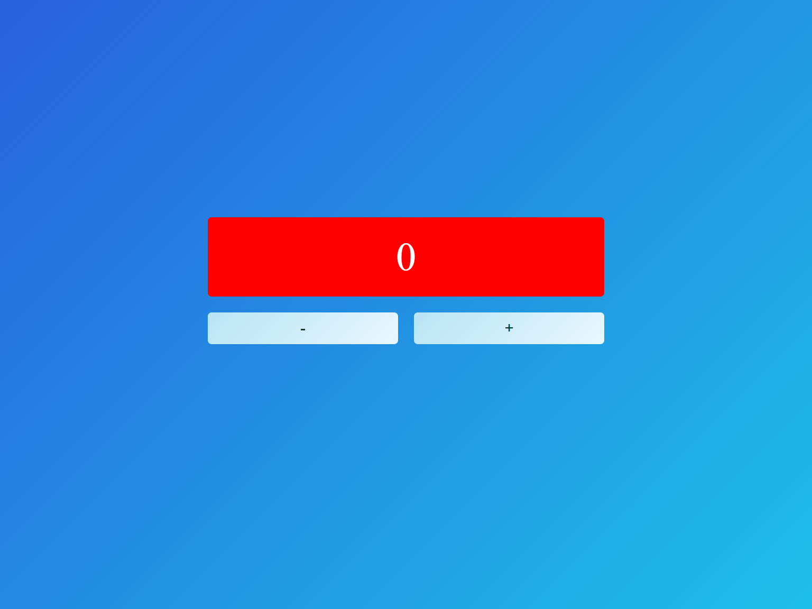

# Кейс-задача № 2. Счётчик

## Описание программы 
 Программа представляет собой простейший счётчик с графическим интерфейсом на HTML/CSS/JS и позволяет:
- увеличивать значение на единицу по нажатию кнопки «+»
- уменьшать значение на единицу по нажатию кнопки «−»
- менять цвет фона окна результата: жёлтый при положительных значениях, зелёный при отрицательных, красный при нуле
- блокировать кнопку «+» при достижении значения 10 и кнопку «−» при достижении значения −10
- показывать надпись «Вы достигли экстремального значения» на экстремальных значениях (-10 и 10)

## Требования
- Любой современный браузер (Chrome, Firefox, Edge, Safari)
- Дополнительные зависимости не требуются (только HTML, CSS и ванильный JavaScript)

## Запуск
Открыть файл `index.html` в браузере

## Пример работы

- [ Значение счетчика равно 0 ] - красный фон, кнопки + и - активны
- [ Значение счетчика больше 0 ] - желтый фон, кнопки + и - активны
- [ Значение счетчика меньше 0 ] - зеленый фон, кнопки + и - активны
- [ Значение счетчика равно -10 ] - зеленый фон, кнопка + - активна, кнопка - - неактивна, отображается сообщение `Вы достигли экстремального значения`
- [ Значение счетчика равно 10 ] - желтый фон, кнопка + - неактивна, кнопка - - активна, отображается сообщение `Вы достигли экстремального значения`
- [ Значение счетчика было равно -10 но изменилось на -9 ] - зеленый фон, кнопка + - активна, кнопка - - была неактивна, но изменила состояние на - активна, сообщение `Вы достигли экстремального значения` скрылось
- [ Значение счетчика было равно 10 но изменилось на 9 ] - желтый фон, кнопка - - активна, кнопка + - была неактивна, но изменила состояние на - активна, сообщение `Вы достигли экстремального значения` скрылось

## Структура проекта
- `index.html` — единственный файл программы (HTML + CSS + JS)

## Функции
| Функция | Назначение |
|---|---|
| `updateUI` | централизованное обновление всех элементов интерфейса |
| `setButtonsStates` | блокировка/разблокировка кнопок на значениях ±10 |
| `resetCounterClasses` | сброс цветовых классов окна результата |
| `setBackgroundStates` | установка цвета фона (красный / жёлтый / зелёный) |
| `setNotificationState` | показ/скрытие надписи на экстремальных значениях |

## Обработка состояний
- Значение 0 → красный фон, обе кнопки активны, надпись скрыта
- Значение > 0 → жёлтый фон
- Значение < 0 → зелёный фон
- Значение 10 → кнопка «+» неактивна, надпись видна
- Значение −10 → кнопка «−» неактивна, надпись видна
- Любое значение, отличное от ±10, разблокирует соответствующую кнопку
